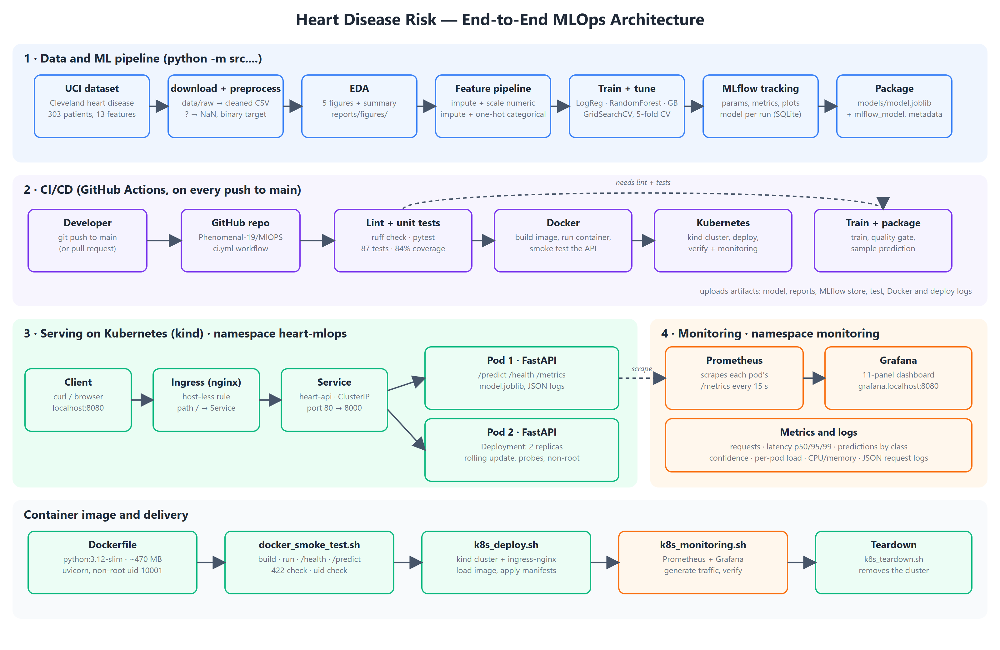

# Heart Disease Risk — End-to-End MLOps

A reproducible machine-learning service that predicts the presence of heart disease from 13 clinical
features (UCI Heart Disease, Cleveland), packaged as a container, deployed to Kubernetes, and monitored
with Prometheus and Grafana. Built for *MLOps (AIMLCZG523) — Assignment 01*.

**Repository:** https://github.com/Phenomenal-19/MlOPS · **Report:** [`docs/MLOps_Assignment_Report.pdf`](docs/MLOps_Assignment_Report.pdf)



## Results at a glance

| Model | CV ROC-AUC | CV recall | Test ROC-AUC | Test recall |
|---|---|---|---|---|
| **Logistic Regression (selected)** | 0.902 ± 0.014 | 0.783 | 0.966 | 0.929 |
| Random Forest | 0.902 ± 0.033 | 0.774 | 0.948 | 0.893 |
| Gradient Boosting | 0.883 ± 0.025 | 0.783 | 0.938 | 0.857 |

5-fold stratified cross-validation on 242 training patients; test metrics are on a held-out 61-patient set.
87 automated tests, 84% line coverage; CI builds the image and deploys it to a throw-away Kubernetes cluster on every push.

## Repository layout

```
src/data/        download.py, preprocess.py        dataset acquisition and cleaning
src/eda/         run_eda.py                        EDA figures
src/features.py                                    shared preprocessing pipeline
src/models/      train.py, package.py, ...         tuning, MLflow tracking, packaging, quality gate
src/predict.py                                     inference helper (CLI + API)
src/api/         app.py, observability.py          FastAPI service, Prometheus metrics, JSON logs
test/                                              pytest suite (87 tests)
k8s/                                               Deployment, Service, Ingress, kind config
k8s/monitoring/                                    Prometheus, Grafana, dashboard (kustomize)
scripts/                                           Docker / Kubernetes / monitoring automation
.github/workflows/ci.yml                           lint -> test -> docker -> kubernetes, train + package
data/processed/heart_clean.csv                     cleaned dataset (raw file is downloaded on demand)
models/                                            packaged model (joblib + MLflow format + metadata)
reports/                                           EDA figures, model comparison
screenshots/                                       evidence for the report
docs/                                              architecture diagram, report
```

## One command on a Linux machine or virtual lab

If you cannot copy and paste long commands, clone the repo and run one script. It creates a Python 3.12
environment, installs the pinned requirements and runs the pipeline, tests and a local API check:

```bash
git clone https://github.com/Phenomenal-19/MlOPS.git && cd MlOPS
bash scripts/lab_run.sh            # ML pipeline + tests + API check (Python only, ~8 min)
bash scripts/lab_run.sh docker     # Docker image build and test (needs Docker)
bash scripts/lab_run.sh k8s        # Kubernetes + monitoring on kind (needs Docker)
```

## Quick start (local, Python 3.12)

```bash
python -m venv .venv
.venv\Scripts\activate                      # Linux/WSL: source .venv/bin/activate
pip install -r requirements.txt

python -m src.data.download                 # fetch the UCI file into data/raw/
python -m src.data.preprocess               # -> data/processed/heart_clean.csv
python -m src.eda.run_eda                   # -> reports/figures/*.png
python -m src.models.train                  # tune 3 models, log every run to MLflow
python -m src.models.package                # export the best run to models/
python -m src.predict --input sample_input.json
```

Browse the experiments: `mlflow ui --backend-store-uri sqlite:///mlflow.db` → http://127.0.0.1:5000

## Run the API locally

```bash
pip install -r requirements-serve.txt
uvicorn src.api.app:app --port 8000
curl -X POST localhost:8000/predict -H "Content-Type: application/json" -d @sample_input.json
```

```json
{"prediction":0,"label":"no heart disease","confidence":0.8345,"risk_probability":0.1655,"model":"logistic_regression"}
```

Endpoints: `POST /predict`, `GET /health`, `GET /` (model info), `GET /metrics` (Prometheus), `GET /docs` (OpenAPI).
Invalid input (out-of-range values, unknown fields) is rejected with HTTP 422; `ca` and `thal` may be omitted.

## Docker (run inside WSL / Linux)

```bash
bash scripts/docker_smoke_test.sh           # build, run, check /health, /predict, 422, non-root user
```

## Kubernetes + monitoring (kind)

Needs Docker. `kind` and `kubectl` are installed into `~/.local/bin` without sudo.

```bash
export PATH="$HOME/.local/bin:$PATH"
bash scripts/k8s_deploy.sh                  # cluster, ingress-nginx, 2 API replicas, verification
bash scripts/k8s_monitoring.sh              # Prometheus + Grafana, traffic, verification
bash scripts/k8s_teardown.sh                # remove the cluster
```

| URL | What |
|---|---|
| http://localhost:8080/docs | API through the ingress |
| http://grafana.localhost:8080 | Grafana, "Heart Disease API" dashboard (demo login `admin` / `heart-grafana`) |
| http://prometheus.localhost:8080/targets | Prometheus targets (both API pods) |

## Tests, lint and CI

```bash
pip install -r requirements-dev.txt
ruff check .
python -m pytest --cov=src
```

The workflow in `.github/workflows/ci.yml` fails on lint errors, failing tests, a degraded model
(`src/models/quality_gate.py`), a broken Docker image or a failed Kubernetes rollout. Each run uploads the
model, reports, MLflow store, coverage and deployment logs as artifacts.

## Notes and limitations

* The dataset is small (303 patients); the 61-patient test set is noisy, so cross-validated scores are the
  headline numbers. This is a teaching project, not a clinical tool.
* Grafana credentials and storage (`emptyDir`) are demo settings for a local cluster.
* `/metrics` is exposed through the same ingress for convenience; restrict it in a real deployment.
